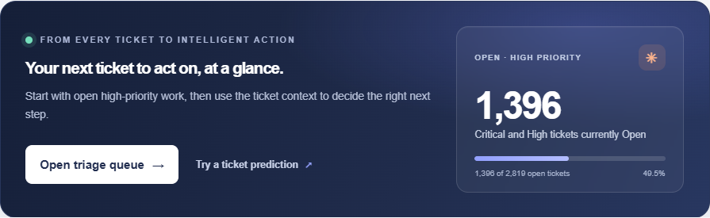
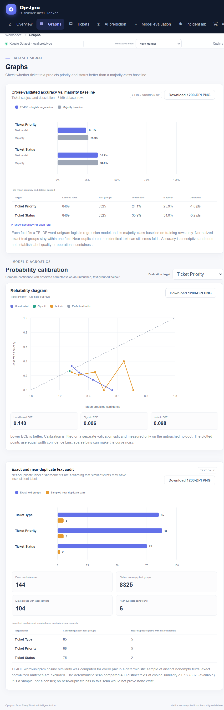
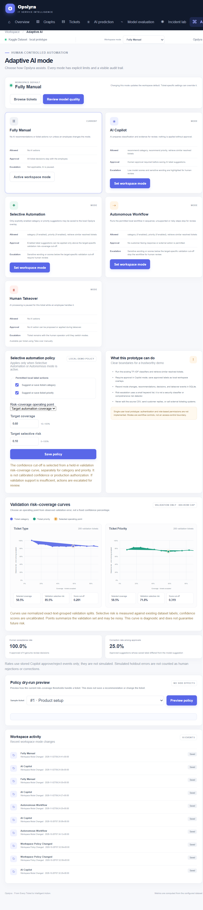
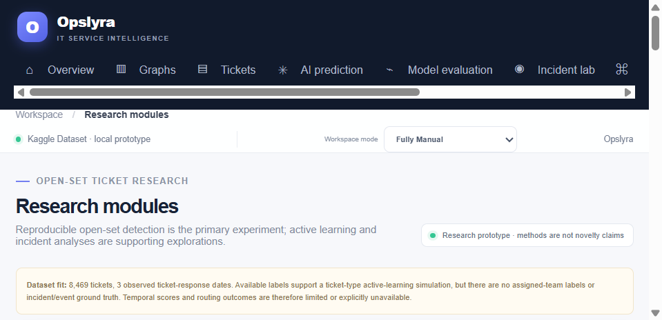

# Opslyra

**From Every Ticket to Intelligent Action.**

Opslyra is a local Flask research prototype for exploring customer-support
tickets, evaluating text-classification methods, and testing human-controlled
AI-assisted workflows. It includes a ticket dashboard, model evaluation,
Graphs, an Incident Lab, Adaptive AI controls, and reproducible research
experiments.

> **Research prototype:** Opslyra is not a production-ready, multi-user
> service. It does not connect to a live ticketing system or send customer
> replies. Read [limitations](#limitations) before using it with sensitive
> data.

## Screenshots

The screenshots show the application UI; the underlying results are generated
from the configured CSV at runtime.

| Overview | Graphs |
|---|---|
|  |  |

| Adaptive AI | Research modules |
|---|---|
|  |  |

## Results on the Bundled Dataset

The following figures were recomputed from the checked-in
`customer_support_tickets.csv` using the current code. The comparison uses
three-fold `StratifiedGroupKFold`; normalized identical ticket text stays in
one fold. The majority baseline is fitted separately on each training fold.

| Prediction target | Labeled rows | Majority accuracy | TF-IDF + Logistic Regression | Difference |
|---|---:|---:|---:|---:|
| Ticket Priority | 8,469 | 25.88% | 24.06% | -1.82 percentage points |
| Ticket Status | 8,469 | 34.02% | 33.85% | -0.17 percentage points |

Neither target beats the majority baseline in this signal check. These results
do not establish that the labels were randomly generated; they show that this
text baseline does not provide an accuracy improvement under this evaluation.

| Dataset audit | Current result |
|---|---:|
| Rows / expected columns | 8,469 / 17 |
| Repeated rows by normalized ticket text | 144 |
| Exact-text groups with at least one conflicting type, priority, or status | 104 |
| Near-duplicate pairs at TF-IDF cosine similarity >= 0.92 | 6 of 400 sampled distinct texts |

The near-duplicate scan is a deterministic sample, not a census. Of its six
pairs, five had disjoint priority labels and two had disjoint status labels.
The exact-text conflicts and weak baseline results are data-quality warnings,
not proof that labels are incorrect.

Results depend on the dataset and software versions. Run the audit and
experiments again after changing the CSV; do not present these figures as
future or production performance.

## Features

- **Dashboard and ticket explorer:** search, filter, inspect, and summarize the
  configured ticket data.
- **Privacy-conscious views:** customer names and email addresses are omitted
  from ticket views; common personal identifiers and credential-like strings
  are redacted from displayed/model text. Redaction is pattern-based and is not
  a guarantee of anonymization.
- **Ticket classification:** separate ticket-type and priority classifiers
  using redacted subject and description text with TF-IDF features.
- **Graphs (`/graphs`):** grouped cross-validated accuracy versus a
  fold-local majority baseline, exact/near-duplicate label-conflict analysis,
  and reliability diagrams/ECE for selectable classification targets. Graph
  downloads are PNGs with 1200-DPI resolution metadata.
- **Adaptive AI (`/adaptive-ai`):** manual, copilot, selective, autonomous,
  and ticket takeover modes; target-specific validation risk–coverage
  operating points; and a side-effect-free policy preview. Human acceptance
  and correction rates are shown only when genuine reviewer events exist.
- **Incident Lab (`/intelligence`):** ten local workflows, including
  corrections, novelty, counterfactual exploration, similarity, routing and
  SLA-risk simulations.
- **Research (`/research`):** open-set detection as the primary experiment,
  with supporting active-learning, constrained-routing, temporal,
  calibration/ablation, and risk–coverage studies.
- **Local audit trail and experiments:** workflow activity and experiment
  records are stored locally under `instance/`.

## Research and Reproducibility

### Evaluation design

The interactive model reports use repeated stratified, exact-text-grouped
cross-validation across multiple seeds, descriptive confidence intervals,
and a separate holdout when class support permits. A chronological
train/test comparison is reported only when timestamps are explicitly
trusted and sufficient data is available. The final model is fitted on
eligible data for prediction; this is separate from the evaluation estimates.

The Research baseline comparison includes majority class, Complement Naive
Bayes, linear SVM, TF-IDF + Logistic Regression, and an embedding + Logistic
Regression path. Sentence-transformer embeddings run only when the optional
package and `OPSLYRA_EMBEDDING_MODEL` are configured; otherwise the embedding
path uses TF-IDF + TruncatedSVD.

### CLI

Python 3.10+ is supported through the compatibility requirements. The pinned
test environment uses Python 3.13.1. From the repository root:

```powershell
python -m venv .venv
.\.venv\Scripts\Activate.ps1
python -m pip install -r requirements-lock.txt
python experiments.py --output instance/experiments --seeds 0,1,2 --folds 3 --max-rows 800 reproduce
```

If GNU Make is installed, the same standard experiment suite can be run with:

```sh
make reproduce
```

Make variables can be overridden, for example:

```sh
make reproduce PYTHON=python SEEDS=0,1,2 MAX_ROWS=800
```

The suite writes dataset audit, model evaluation, calibration/ablation,
open-set, and risk–coverage JSON records under `instance/experiments/`.
Individual commands are `audit`, `evaluate`, `ablation`, `openset`,
`risk-coverage`, and `kappa`. Options go before the subcommand. For example:

```powershell
python experiments.py --output instance/experiments --seeds 0,1,2 --unknown "Refund request" openset
```

Independent label agreement is not currently measured. To calculate Cohen's
kappa from two independently produced annotation CSVs, see
[the annotation guide](docs/ANNOTATION_GUIDE.md). Do not treat the bundled
labels as independently verified operational ground truth.

## Dataset and Provenance

The bundled CSV has 8,469 rows and 17 required columns, including ticket
subject, description, type, status, and priority. The project identifies the
file as sourced from Kaggle. The exact Kaggle listing, citation, license,
retrieval date, and independent verification of labels/timestamps have not
been recorded. Check the original Kaggle terms before redistribution or reuse;
the repository's MIT license does **not** license the dataset.

Missing values remain missing in the raw and analysis data. They are not
replaced with invented labels. The current CSV has 5,700 missing values in
each of `Resolution`, `Time to Resolution`, and `Customer Satisfaction
Rating`, and 2,819 in `First Response Time`. Counts should be recomputed if
the dataset changes.

To use another CSV, set `TICKETMIND_DATASET` to its path. Include all required
columns. A provenance sidecar named `<csv-filename>.provenance.json` should
record source, citation, license, retrieval date, and label/timestamp
verification status. See the example in [Configuration](#configuration).

## Installation and Run

### Windows PowerShell

```powershell
py -m venv .venv
.\.venv\Scripts\Activate.ps1
python -m pip install -r requirements-lock.txt
$env:OPSLYRA_SECRET_KEY = "use-a-long-random-secret"
python app.py
```

Open <http://127.0.0.1:5000>. To use a different CSV:

```powershell
$env:TICKETMIND_DATASET = "C:\path\to\tickets.csv"
python app.py
```

On other platforms, create/activate a virtual environment and install the
appropriate requirements file. Use `requirements-lock.txt` for the pinned
Python 3.13.1 environment; use `requirements.txt` for the supported
compatibility range.

### Configuration

| Variable | Purpose | Default |
|---|---|---|
| `TICKETMIND_DATASET` | Input CSV | `customer_support_tickets.csv` beside `app.py` |
| `OPSLYRA_SECRET_KEY` | Flask session signing key | Random per process if unset |
| `HOST` | Development server bind address | `127.0.0.1` |
| `PORT` | Development server port | `5000` |
| `FLASK_DEBUG` | Enable Flask debug mode when set to `true` | Disabled |

For alternate datasets, place a JSON file beside the CSV with `.provenance.json`
appended to its filename:

```json
{
  "source_kind": "external",
  "source": "Dataset source name",
  "label": "External dataset",
  "citation": "Publication or source URL",
  "license": "License identifier or pending review",
  "retrieval_date": "YYYY-MM-DD",
  "labels_verified": false,
  "timestamps_trustworthy": false
}
```

Only mark labels or timestamps verified when the supporting evidence has been
independently checked and documented.

## Tests and CI

Run the test suite locally:

```powershell
python -m pytest -q
```

GitHub Actions runs pytest on Python 3.10 using `requirements.txt` and Python
3.13.1 using the exact pins in `requirements-lock.txt`. The workflow is
`.github/workflows/ci.yml`.

## CSRF Protection

All unsafe HTTP methods are checked by a global Flask request hook against a
session-bound CSRF token. HTML forms submit the token as a form field, and
JSON requests send it in the `X-CSRF-Token` header. Requests without a valid
token are rejected with HTTP 403. This is a local prototype safeguard; it is
not authentication or authorization.

## Technology

- Python, Flask, SQLite
- pandas, NumPy, SciPy, scikit-learn
- HTML, CSS, JavaScript, and inline SVG/chart visualizations
- pytest and GitHub Actions

## Limitations

- This is a single-user local research prototype, not an authenticated
  multi-user service or production ticketing system.
- Dataset identity is attributed to Kaggle by the project owner, but its
  exact source citation, terms, and label verification are not recorded.
- Confidence scores are not automatically calibrated. Risk–coverage points
  are validation diagnostics and do not guarantee future risk.
- Open-set held-out classes are proxies for unseen incidents, not verified
  out-of-distribution production events.
- The ticket dataset has no assigned-team ground truth or verified SLA-breach
  labels; routing and SLA outcomes are simulations.
- Available response-time dates are insufficient for reliable recurrence
  forecasting.
- Redaction uses patterns and does not guarantee removal of all personal or
  sensitive information.

## License

Opslyra source code and project documentation are licensed under the MIT
License; see [LICENSE](LICENSE). The dataset and any third-party materials
are excluded from that grant and remain subject to their own terms.

---

**Opslyra — From Every Ticket to Intelligent Action.**
